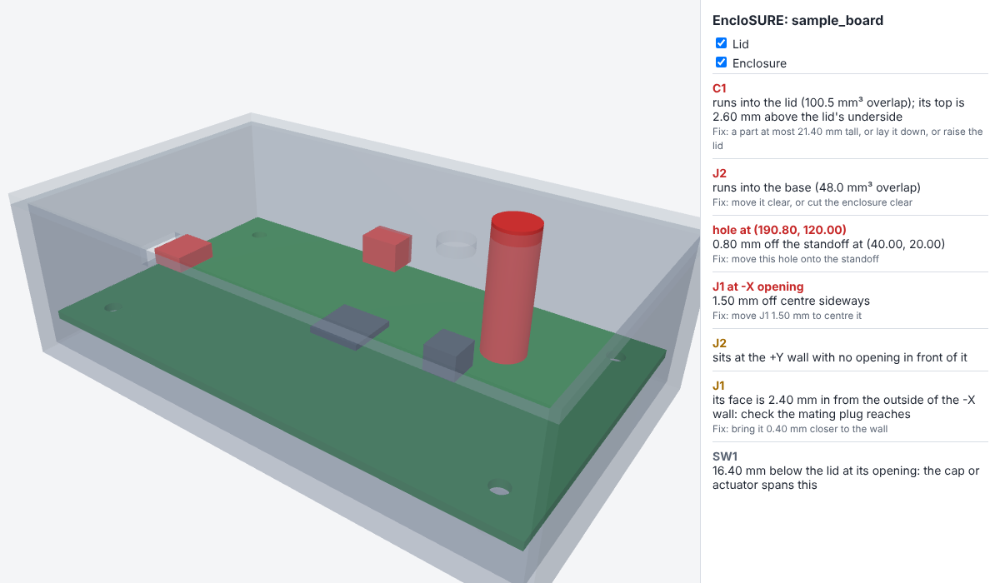
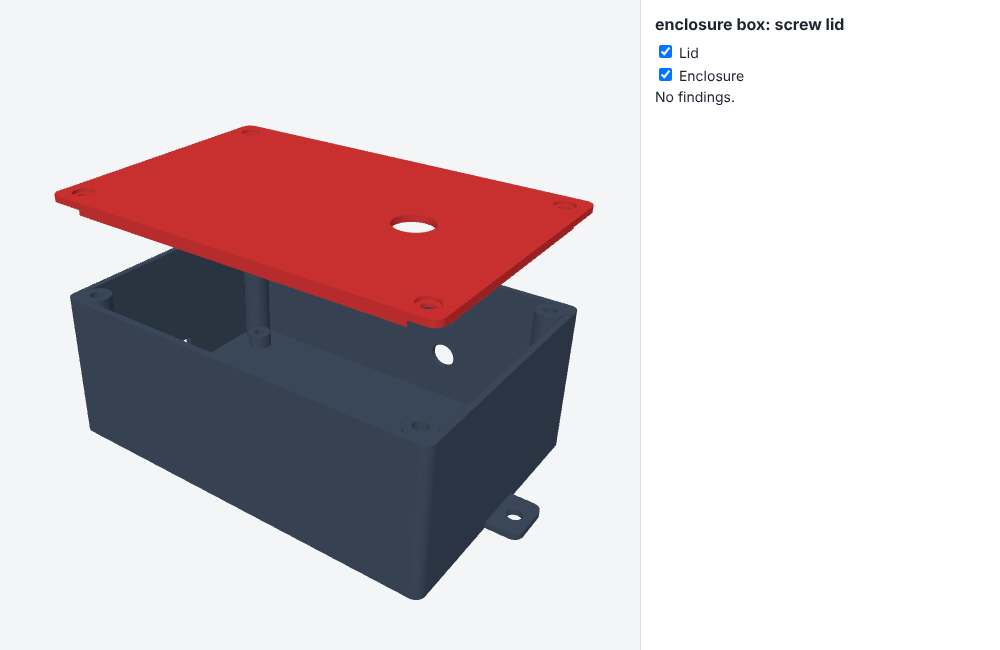
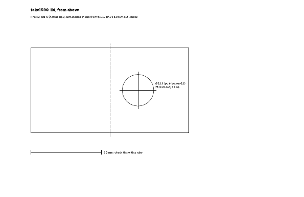
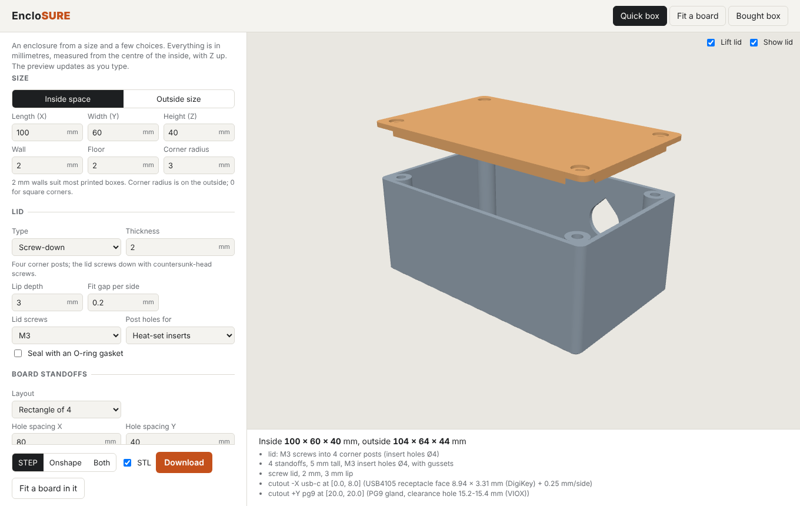

# encloSURE

Make a PCB and its enclosure fit each other.

Give EncloSURE the enclosure you modelled (a STEP from Onshape, SolidWorks or any CAD) and it:

1. **Reads the enclosure**: the inside cavity, the floor, the lid's underside, each standoff (and
   the screw its hole takes), and every opening in the walls, floor and lid.
2. **Starts the board for you in KiCad**: the board outline that fits the cavity, a mounting hole
   on every standoff sized for its screw with a keepout for the screw head, the tallest part
   allowed on top and underneath, and a marker where each wall or lid opening lands on the board.
3. **Checks the finished board**: drop in KiCad's 3D STEP export and it seats the board on its
   standoffs (by matching mounting holes), then reports every collision, part too tall for the
   lid, connector off its opening (or an opening too small for it), mounting hole off its
   standoff, and edge too close to a wall. Each problem comes with the fix, and a move in KiCad
   coordinates where a move fixes it. You get a punch list and a 3D view with the problem parts
   in red.

It is built to sit beside [Backplane](https://github.com/i2cjak/Backplane): `skills/enclosure-fit`
is a skill an agent there can follow to run the check, apply the KiCad moves, and re-check.



It also works the other way round: give it a finished board and it designs the box around it
(`enclosure frompcb`), and when a fit check asks for KiCad moves, `enclosure fix` applies them to
the `.kicad_pcb` for you.

## Just a box

Not every project needs the board side. `enclosure box` makes an enclosure from a size and a
few choices, as STEP files you open and keep editing in Onshape or SolidWorks (they import as
solid bodies, ready for direct edits or new features), plus STL files to print:

```
enclosure box --size 120x80x45 --lid screw --standoffs rect:100x60 --standoff-screw M2.5 \
    --cutout left:rect:9.5x3.8r1@0,9 --cutout lid:round:12@30,0 --flange 10 -o my_box
```



This writes `base.step`, `lid.step`, `assembly.step` (the lid in place), `base.stl`, `lid.stl` (lid
flipped for printing) and `box.json`, the settings. `enclosure box --from my_box/box.json --lid
snap -o my_box_v2` rebuilds it with one thing changed.

| Choice | Flags | Default |
|---|---|---|
| Size | `--size LxWxH` (the space inside), `--outer` to give the outside instead | 100x60x40 |
| Walls | `--wall`, `--floor`, `--radius` (outside corners, 0 for square) | 2, 2, 3 mm |
| Lid | `--lid screw` (corner posts), `friction` (press-in lip), `snap` (lip with a rib that clicks into a groove), `slide` (panel in grooves, open end), `none` | screw |
| Lid details | `--lid-thickness`, `--lip` (0 for none), `--clearance` (gap between mating parts per side) | 2, 3, 0.2 mm |
| Lid screws | `--lid-screw M2..M4`, `--lid-screw-hole tap` (thread-forming pilot), `insert` (heat-set), `clearance` (through, for a nut) | M3 insert |
| Board standoffs | `--standoffs rect:AxB` or `x,y;x,y`, `--standoff-height`, `--standoff-screw`, `--standoff-hole` | none |
| Inserts | `--insert-hole`, `--insert-depth`: check your insert's datasheet, brands differ | per screw |
| Cutouts | `--cutout FACE:PRESET@a,b` (see below), `FACE:rect:WxH[rR]@a,b` or `FACE:round:D@a,b`; FACE is `left right front back lid floor` (or -X +X -Y +Y); on a wall, a is along the wall from its centre and b the height above the inside floor | none |
| Mounting ears | `--flange` (how far out), `--flange-screw` | none |
| Sealing | `--gasket D`: an O-ring cord groove in the lid, pressing on a ledge inside the walls (screw lid only; about 25% squeeze) | none |
| Vents | `--vent FACE:WxH@a,b[:slot[:pitch]]`: slots filling an area (repeatable) | none |
| Feet | `--feet D`, `--feet-depth`: four recesses under the floor for stick-on rubber feet | none |
| Hanging | `--keyholes M3/M4`, `--keyhole-spacing`: two keyholes in the floor | none |
| DIN rail | `--din-rail`: a TS35 clip under the floor (print a test first; the latch is sprung plastic) | off |
| Labels | `--label FACE:TEXT@a,b[:size[:depth]]`: raised text, or recessed with a negative depth | none |
| Snap-in pins | `standoff_hole: "pin"` in box.json, or "Snap-in pins" on the page: a split peg with a barb goes up through each mounting hole and the board clicks down | screws |
| Card guides | `card_slots: [x, ...]`, `board_thickness`: rails on the front and back walls hold a board standing across the box | none |
| Windows | `windows: [{face, size, at, panel, panel_t}]`: an opening with a recess behind it for a clear panel or a display's glass, glued in from inside | none |
| Lid posts | `lid_standoffs: [[x, y], ...]`, `lid_standoff_height`, `lid_standoff_screw`: posts hanging from the lid for a display or button board behind it | none |
| Batteries | `batteries: [{cell: AA, AAA, 18650 or 21700, count, at, axis}]`: a cradle on the floor with room for spring contacts | none |
| Cables | `tie_points: [[x, y]]` (zip-tie anchors), `cable_notches: [{face, at, d}]` (a U in the top of a wall the lid closes) | none |
| Material | `material`: PETG, PLA, ABS or ASA, for the weight estimate | PETG |
| Clamshell | `--lid clamshell`, `split` (0.2 to 0.8 of the inside height): two shells with a tongue and groove, screwed from the top; for tall or handheld boxes | |
| Light pipes | `light_pipes: [{at, d}]`: tubes from the lid to 1 mm above each LED, for a light pipe or clear rod | none |
| Heat | `power_w`: the air's rise over the room, sealed and with the vents (a rough still-air estimate) | 0 |

Every box also says how to lay each part on the print bed, writes `support_enforcers.stl` (blocks a
slicer can use to force support in the flat-topped wall openings) when it needs one, reports a rough
weight and print time, and flags what prints badly: walls under
1.2 mm, flat-topped wall openings over 10 mm that need bridging or support, round wall holes without
teardrops, and raised text under 4 mm.
| Printing | `--no-teardrop` (round wall holes over 5 mm get 45° sides with a short flat top by default, so they print without support and stay their own height), `--bottom-chamfer` (against first-layer squish), `--no-ribs` (gussets at the standoffs' feet) | on, 0.4 mm, on |
| Output | `--format step` (STEP and STL), `onshape` (an Onshape custom feature), or `both`; `--no-stl` | step |

Positions are from the centre of the inside, Z up. A box made this way reads straight back into
`enclosure read`, `limits` and `fit`, so a board can be designed into it later. Each run also
lists checks worth a look: an insert hole deeper than its post, a gland whose locknut will not
clear the floor, a keyhole under a standoff.

### Presets

`--cutout back:pg9@20,20` cuts the hole for a named part. `enclosure presets` lists them. Each
size is the maker's recommended hole where one is published, otherwise the thread plus 0.5 mm;
check the datasheet of the exact part you buy.

| Preset | Hole, mm | From |
|---|---|---|
| `usb-c` | 9.5 x 3.85 | USB4105 receptacle face 8.94 x 3.31 mm (DigiKey) + 0.25 mm/side |
| `keystone` | 14.9 x 19.2 | keystone module cutout 14.9 x 19.2 mm (Delock) |
| `pushbutton-22` | ⌀22.3 | 22 mm pushbuttons mount in a 22.3 mm hole (Omron) |
| `toggle-1/4` | ⌀6.5 | 1/4-40 bushing (6.35 mm) + clearance |
| `toggle-15/32` | ⌀12.2 | 15/32-32 bushing (11.9 mm) + clearance |
| `pg7` | ⌀12.7 | PG7 gland, clearance hole 12.5-12.7 mm (VIOX) |
| `pg9` | ⌀15.4 | PG9 gland, clearance hole 15.2-15.4 mm (VIOX) |
| `pg11` | ⌀18.8 | PG11 gland, clearance hole 18.6-18.8 mm (VIOX) |
| `pg13.5` | ⌀20.6 | PG13.5 gland, clearance hole 20.4-20.6 mm (VIOX) |
| `pg16` | ⌀22.7 | PG16 gland, clearance hole 22.5-22.7 mm (VIOX) |
| `pg21` | ⌀28.5 | PG21 gland, clearance hole 28.3-28.5 mm (VIOX) |
| `m12` | ⌀12.5 | M12x1.5 gland or M12 vent plug: 12 mm thread + 0.5 mm |
| `m16` | ⌀16.5 | M16x1.5 gland: 16 mm thread + 0.5 mm |
| `m20` | ⌀20.5 | M20x1.5 gland: 20 mm thread + 0.5 mm |
| `m25` | ⌀25.5 | M25x1.5 gland: 25 mm thread + 0.5 mm |
| `m8-panel` | ⌀8.5 | M8 panel connector: 8 mm thread + 0.5 mm |
| `m12-panel` | ⌀12.5 | M12 panel connector: 12 mm thread + 0.5 mm |
| `iec-c14` | 27.5 x 20 | IEC C14 snap-in inlet, for 1 to 3 mm panels (Interpower) |
| `fuse-5x20` | ⌀13 | Schurter FEF fuse holder (its 12 mm flat is left out: tighten the nut well) |
| `fan-40` | ⌀37 + 4 x ⌀3.5 on 32 | San Ace 109P0412H3013, Noctua NF-A4x10 |
| `fan-60` | ⌀57 + 4 x ⌀4.5 on 50 | San Ace 60GT25 mounting reference |
| `fan-80` | ⌀76 + 4 x ⌀4.5 on 71.5 | San Ace 9G0824G102 |
| `drain` | ⌀3 | 3 mm drain hole |

A fan preset adds its four screw holes as plain round cutouts, so every output (STEP, Onshape,
SolidWorks, drawings) gets them. The fan openings are the frame less about 3 mm, a choice rather
than a maker's figure.

### Hinged lid

`--lid hinge` puts five knuckles along the +Y edge (three on the base on 45 degree wedges, so the
base prints upright without support; two on the lid, flush with its top so it prints top down) and a
snap rib on -Y to hold it shut. The pin is a piece of 1.75 mm filament through a 2.1 mm hole; melt
its ends. The lid was checked to swing all the way over without touching the base. Onshape and the
SolidWorks macro make it as a press-fit lid without the knuckles, and say so.

### In SolidWorks: a macro

`--format solidworks` writes `enclosure_box.swb` next to the STEP. In SolidWorks: Tools > Macro >
Run, pick the file. It builds the box as features (extrude, fillet, shell, posts, standoffs, lid,
cutouts) so it stays editable, and the command lists what it leaves out. It has not been run in
every SolidWorks version yet: send any error it gives.

### In Onshape: the custom feature

`--format onshape` (or `both`) writes `enclosure_box.fs`, an Onshape custom feature with your
settings as its defaults. To use it:

1. In an Onshape document, add a Feature Studio (the + at the bottom left, "Create Feature Studio").
2. Select everything in it, paste in the file's text, and commit.
3. In a Part Studio, find **EncloSURE Box** on the toolbar's custom features (in another
   document, add it with "Add custom features" first).

It makes the Base and Lid as parts, and every setting stays editable in the feature's dialog:
size, walls, corner radius, screw or friction lid, lip, corner posts, a rectangle of board
standoffs, and round or rectangular cutouts (with rounded corners) on any face. Vents, feet,
windows, card guides and the bottom chamfer come along too, at the sizes you set, and follow the box
when its size changes in the dialog. Gaskets, keyholes, the DIN clip, labels, ears, gussets, pins
and teardrops are in the STEP only, and the command lists which of your settings the feature leaves
out. Run `--format both` to have both. The geometry was checked in
Onshape against the STEP build (the base's volume matches within 0.01%).

## Describe it in words

```
enclosure describe "Arduino Uno, USB-C, two buttons, OLED, wall-mounted, splash-proof" -o first
```

A first box and the KiCad board to start in, from a few words. It reads keywords, not meaning: a
known board (Raspberry Pi, Pi Zero, Arduino Uno or Mega, with their published mounting holes) or a
size like 80x50; connectors and controls by name and count (USB-C, micro-USB, Ethernet, barrel jack,
SMA, BNC, toggle, 22 mm buttons, buttons, LEDs, glands); a display (OLED, 16x2 LCD, TFT: typical
window sizes, set yours from the module); batteries (AA, AAA, 18650, 21700); and where it lives
(splash-proof, wall-mounted, DIN, on a desk, hot). Everything it assumed is listed, and wall openings
start spread round the walls, to move to where your connectors are.

## A box around a board

```
enclosure frompcb board.step --lid friction -o my_box     # KiCad's STEP export, with 3D models
```

The box is sized around the board: a gap each side (1 mm), less on an edge with a connector so its
face sits close to the outside where a plug reaches it; a standoff under every mounting hole for the
screw it takes, tall enough to clear parts underneath; the inside height clears the tallest part plus
headroom and the lid's lip; and an opening in front of every part that reaches an edge, its face plus
0.5 mm a side (or the datasheet cutout from `--parts parts.json`). A screw lid's corner posts would
land on a board that fills the box, so with a screw lid the box grows along one axis to clear them
(the notes say which); a press-fit or snap lid doesn't need that. The board is then checked inside
the box (`my_box/fit/`), and `my_box/box.json` holds every setting to change with `enclosure box --from`.

The board can also be just the `.kicad_pcb` (`enclosure frompcb board.kicad_pcb`): its Edge.Cuts
outline (lines, arcs, rectangles, circles, polygons, any shape), its mounting holes and each
footprint's courtyard become the board, with heights from parts.json or typical ones for each kind of
part (listed in the notes), so openings land where the connectors really are.

A second board stacked on the first (a Raspberry Pi HAT, an Arduino shield) comes in with
`board2`/`pcb2` on the page or the API and a gap between the boards (11 mm by default): its plate is
PCB2 and its parts are named like `J1/top`, so they count for room and get openings like any other. `enclosure describe
"... wall-mounted" --pcb board.kicad_pcb` does the same and adds what the words say.

## Fixing the board

```
enclosure fit base.step board.step --lid lid.step -o fit
enclosure fix board.kicad_pcb fit/report.json -o board_fixed.kicad_pcb
```

`fix` moves each footprint the report asks to move (a connector onto its opening, a mounting hole
onto its standoff) and writes a new file; the original is left alone. Re-export the STEP from KiCad
and check again. Problems a move can't fix (a part too tall, an opening too small) are listed.

## Fixing it automatically

A connector sitting beside an empty opening on the same wall is paired with it: the finding says how
far to move it, and the fixed `.kicad_pcb` has it moved there.

```
enclosure autofit base.step board.kicad_pcb --lid lid.step -o autofit
```

Round after round: export the STEP with `kicad-cli` (Backplane's, through `$BACKPLANE_KICAD_CLI`,
inside Backplane), check, move what the check asks to move, until the board fits or a round asks for
nothing a move can fix. Your board is left alone; the result is `autofit/board_fixed.kicad_pcb`, with
each round's report beside it. The `enclosure-fit` skill tells an agent in Backplane to use it.

## Worst-case gaps

`enclosure fit` (and the page's fit check) also writes `tolerances.json`: each board edge's gap and
each screw's play once the fab's outline tolerance, where the printer puts things and the plastic's
shrink all go the wrong way at once, with a warning where the board may not drop in or a screw may
not go in. The figures are typical (±0.2 mm board outline, ±0.1 mm holes, ±0.15 mm printing, PETG
0.4% shrink); change them in `enclosure.tolerance.Tolerances`. The fit check also tests the board
itself against the box now (corner posts, ribs, a gasket ledge), not only its outline's box against
the walls, and `limits` draws the board's outline round whatever is at board height.

## Fit test print

`enclosure coupon -o coupon` (or "Print a fit test" on the page) writes a plate of pockets and six
plugs, each smaller by a different gap per side from 0.10 to 0.35 mm, the gap printed on each. Print
both, try each plug, and set the box's fit gap to the one that fits the way you want.

## Drawings

```
enclosure drawing my_box --standard asme --part-number ENC-001 -o drawings
```

An ASME (inch, Y14.5) or ISO (mm) drawing of the base and lid as PDF and SVG, made by the
[draftwright fork](https://github.com/ethanmarshall/draftwright-rust): build it (`cargo build
--release`) and set `DRAFTWRIGHT` to the binary. It works on a drilled bought box too, for a
machinist. The web page has it built in (the Dockerfile builds draftwright at a fixed commit).

## Exploded assembly and parts list

```
enclosure assembly my_box/box.json --board board.step -o assembly
```

The base, board, lid and screws pulled apart along Z, drawn by draftwright's assembly pack with
balloons and a parts list (`assembly/pack/pack.pdf`), plus `parts_list.csv` (screws sized to stock
lengths, inserts, the O-ring cord, feet and panel parts) and the exploded STEP.

## Parts: screws, nuts, washers, springs, clips

```
enclosure part screw size=M3 length=12 type=button          # a reference ISO 7380 button head screw
enclosure part nut size=M8 mode=print                        # a nut to print, threads 0.2 mm oversize
enclosure part compression_spring d=1 od=10 free_length=20 coils=8 working_length=14
enclosure part list                                          # every part and its settings
```

Each part comes as STEP and STL with a notes file, and the page's Parts tab draws it as you change it.

- **Reference** parts are the standard part at its standard size, from
  [bd_warehouse](https://github.com/gumyr/bd_warehouse)'s tables: socket, button, flat, hex, pan
  and set screws (ISO 4762, 7380, 10642, 4017, 14583, 4026; ASME B18.3 and B18.6.3 in inch sizes), hex,
  thin, square, flange and cap nuts, plain washers (ISO 7089 to 7094) and heat-set inserts. Inch hex
  nuts follow ASME B18.6.3 and B18.2.2. Threads are drawn plain so assemblies stay quick; turn on
  `threads=true` to model them.
- **For printing** (`mode=print`), threads are always modelled, `clearance` (0.2 mm by default)
  smaller on bolts and bigger in nuts and holes, so a printed bolt turns into a printed nut. Under M6
  the page says printed threads come out rough and suggests an insert.
- **Springs**: compression (closed, closed and ground, or open ends), extension (a crossover loop
  each end) and torsion (tangent legs). The rate, solid height, force at your working length and the
  wire's stress against what it takes are worked out as in Shigley's *Mechanical Engineering Design*
  (music wire, 302 stainless or hard-drawn steel). Printed springs get a rough rate and a warning.
- **Clips**: a snap-fit hook with its strain, push-on and pull-off forces (the straight-beam
  formulas from the Bayer snap-fit guide), a snap-in cable clip, a cable-tie mount, a board edge
  clip, and the DIN rail clip on its own plate. The strain limits for printed plastics are rules of
  thumb: print one and try it.
- **Gears and pulleys**: involute spur gears (bd_warehouse) with a bore, hub and set screw; GT2 timing
  pulleys from the tooth count (pitch diameter = teeth x 2 / pi, outside 0.508 mm smaller), with a
  round-bottomed stand-in for the GT2 groove.
- **Knobs and caps**: knobs for 6 mm D-shafts (4.5 mm flat), round shafts with a set screw, or
  knurled shafts; button caps for tactile switches that report the panel hole to cut.
- **Hinges and latches**: a two-leaf hinge with a filament or M3 pin, and a snap latch with its keeper.
- **Test print** (`test_print`): a strip of threaded holes at several clearances with a bolt for each,
  and snap hooks of three undercuts with a plate to push them through. Print it once; the clearance
  that turns by hand is the one to use.

### Print plate

`POST /api/plate` (the Print plate panel on the Parts tab) lays the box's printed parts and any parts
out on your bed, each turned the way it prints best, as a 3MF. With PrusaSlicer on the server (the
Docker image has it) it also slices the plate for the real print time and grams, which the summary
PDF and parts list then use. The times come from PrusaSlicer's default printer settings: your own
profile will differ.

## Made another way

The Quick box tab's "Made another way" makes the same inside size and holes as:

- **Bent sheet metal**: a base (floor, end walls, side lips) and a cover (top and sides) that screws
  to the lips, as flat pattern DXFs with bend lines (layer BEND) and a formed STEP. Flat lengths use
  the bend allowance BA = (pi/2)(R + K t) per bend; check your shop's K-factor or bend table.
- **Laser-cut panels**: six panels with finger joints from one DXF, outlines grown by half the kerf.
- **A moulding check**: draft on faces along the pull, even walls, boss and rib thickness against the
  wall, inside corner radii, the wall range for the resin (Protolabs' table), and openings that need
  side actions in the mould.

## More on the box

- **Screws**: board and lid screws are picked from stock lengths so they never bottom out and bite
  enough (or give your own length); a screw that's too long or too short is flagged. The assembly
  uses real ISO 4762 screws and heat-set inserts.
- **Honeycomb vents**, counted in the temperature estimate.
- **Battery door**: an opening in the floor with a flush door that screws on (the door is its own part).
- **Cable strain relief**: a hole for the cable and a clamp bar on two posts inside.
- **Wall bracket**: a French cleat under the floor and a bracket to screw to the wall.
- **Stacking**: pins on the lid and sockets under the floor.
- **Getting the board in**: the fit check lowers the board in from above and says whether anything
  stands over it, and whether connectors reaching into wall openings need the board slid or tilted in.
- **Parts in the team library** next to boxes, and **parts to Onshape** (imported as a Part Studio).

## A box you bought

`enclosure stock` puts cutouts in an off-the-shelf box and prints drilling templates for it.
Download the maker's STEP for your box (Hammond has one on each 1590 die-cast product page),
stand it with its opening up, and give it cutouts in the same syntax as `enclosure box`:

```
enclosure stock 1590B.step --cutout front:pg9@0,12 --cutout lid:pushbutton-22@0,0 -o drill
```

You get `base.step` and `lid.step` with the holes cut, in the maker's own position, each face's
holes as a 1:1 DXF (for a laser, router or CAM) and as G-code (drilled up to 6.5 mm, bigger holes
milled in a helix, rectangles as an inside contour; the feeds and speeds are placeholders for a 1/8"
end mill in aluminium: set yours and dry-run it), and `drill_templates.pdf`: one page per face as seen from outside, at 1:1 on Letter paper, with each
hole drawn, a centre-punch cross, and its position from the face's bottom-left corner. Print it
at 100% ("Actual size"), check the 50 mm bar with a ruler, tape it on and drill. A file holding
both the box and the lid is split by shape (the taller solid is the box); a separate lid goes
in with `--lid`. A die-cast wall has draft, so the outline on the page is the face's widest
extent: measure from the bottom edge and the centre line.



## In a browser

`enclosure web` serves everything as a page, live at https://enclosure-jdxs.onrender.com:

- **Quick box**: every option as a form field (holes picked from the presets or your own size,
  vents, text, standoffs as a rectangle or your own positions), a live 3D preview, and a choice of
  STEP, Onshape feature or both to download.
- **Fit a board**: read your quick box, an uploaded enclosure STEP or the sample; download the
  KiCad board to design in; then upload KiCad's STEP export (plus the .kicad_pcb and parts.json
  if you have them) to check the fit, with each problem's fix, the KiCad move, and a 3D view.
- **Bought box**: holes in a maker's STEP and the drilling templates.

"Describe it in words" and "Start from a finished board" on the Quick box tab start a design;
"Download drawings" and "Exploded assembly + parts list" make the drawings; the Bought box tab can
add a drawing for the machinist. "Start from a finished board" designs the box around an uploaded board STEP and
fills in the form. A fit check with the `.kicad_pcb` uploaded hands back a fixed copy. "Copy share
link" puts every setting in the link, "Open box.json" loads a saved design, "Save version" keeps
numbered versions in that browser to open, download or delete, and the page remembers your last box. Set `ENCLOSURE_PASSWORD` on the server to make the page ask for a
password (any user name).

```
pip install -e ".[web]"
enclosure web            # then open http://localhost:8000
```



It runs anywhere Docker does (`docker build -t enclosure .`), including a host such as Render;
a box takes a second or two to build.

More on the page:

- **mm or inches**: every length field, and the report's notes, in either.
- **Onshape**: "Send to Onshape" makes a document with the box built in it; "Update in Onshape"
  changes that same document when you change the box (your own features after it stay). The Fit tab
  can read an enclosure straight from a Part Studio link. Needs `ONSHAPE_ACCESS_KEY` and
  `ONSHAPE_SECRET_KEY` on the server.
- **Cost and summary**: the parts list with DigiKey parts and prices (with `DIGIKEY_CLIENT_ID` and
  `DIGIKEY_CLIENT_SECRET` on the server) plus the plastic at your price per kg, and a one-page PDF
  of the box.
- **Compare**: each saved version can be compared with the box on the page, setting by setting.
- **Install as an app**: in Edge or Chrome, the install icon in the address bar (or Settings >
  Apps > Install this site as an app) gives EncloSURE its own window and icon.

## Install

Python 3.10 or later. EncloSURE writes and reads KiCad boards itself (KiCad 7 format, which
KiCad 7 through 10 and Backplane's KiCad open), so KiCad is only needed to design the board and
export it to STEP.

```
pip install -e .            # installs build123d (OpenCascade) and the `enclosure` command
pip install -e ".[web]"     # adds the web page
```

## Use

```
enclosure sample -o sample                         # a sample enclosure, lid and board
enclosure read   sample/sample_base.step --lid sample/sample_lid.step
enclosure limits sample/sample_base.step --lid sample/sample_lid.step -o board/board.kicad_pcb
kicad-cli pcb export step -o board.step board/board.kicad_pcb     # once you have designed it
enclosure fit    sample/sample_base.step board.step --lid sample/sample_lid.step -o fit
```

`fit` writes `fit/report.json`, `fit/punch_list.md` and `fit/view.html` (open it in any browser;
it loads three.js from a CDN). It exits 0 when the board fits and 1 when it does not.

The sample board has four planted problems, and `fit` finds them all:

| Problem | What EncloSURE says |
|---|---|
| A mounting hole 0.8 mm off its standoff | move it X -0.80 mm |
| The USB-C receptacle 1.5 mm off its opening | move J1 Y +1.50 mm in KiCad |
| A capacitor 2.6 mm too tall for the lid | a part at most 21.40 mm tall |
| A connector pushed into the +Y wall | collision, and no opening in front of it |

### Conventions

- Z is up: the direction the lid comes off. Millimetres. The base and lid are in one frame.
- The base is an open-topped shell; standoffs are round, rising from the floor.
- The board STEP is KiCad's export: KiCad names each part's instance by its reference (J1), which
  EncloSURE reads. A part without a 3D model is not in the export, so it cannot be checked.
- KiCad's Y axis points down the page, so KiCad moves have Y flipped from the enclosure's.

### Settings

`fit --clearance 0.5` (part and board edge to the enclosure), `--opening-margin 0.25` (an
opening clear of a connector's face on each side), `--max-setback 2.0` (a connector's face back
from the outside of the wall before the plug may not reach; check your plug's datasheet),
`--place x,y,z,rotation` (put the board somewhere other than on its standoffs).

## Real parts: datasheets, DigiKey and Mouser

A project's `parts.json` holds what the fit check should know about each part, by reference:

```json
{"parts": {
  "J1": {"mpn": "USB4105-GF-A", "manufacturer": "GCT", "datasheet": "https://...",
         "body": [8.94, 7.35, 3.31], "height": 3.31,
         "cutout": {"width": 9.8, "height": 4.0, "max_setback": 1.0},
         "source": {"height": "DigiKey: Height - Seated (Max)", "cutout": "datasheet p.2"}}}}
```

- `body` (length × width × height above the board, mm) lets `fit` check a part **with no 3D model**:
  it stands in a block of that size where the footprint sits on the board (`fit --pcb`).
  Without it, such a part is reported as not checked.
- `height` is checked against the part's 3D model, which is sometimes the wrong variant.
- `cutout` is the connector datasheet's recommended panel opening and how far back the
  receptacle may sit: `fit` holds the enclosure's opening to it instead of a generic margin.

`enclosure parts` builds the file and fills it from the distributors:

```
export DIGIKEY_CLIENT_ID=... DIGIKEY_CLIENT_SECRET=...   # developer.digikey.com, Product Information v4
export MOUSER_API_KEY=...                                # mouser.com Search API
enclosure parts --pcb board.kicad_pcb                    # MPNs from each footprint's MPN field
enclosure parts --set J1=USB4105-GF-A --set SW1=B3U-1000P
enclosure fit base.step board.step --lid lid.step --pcb board.kicad_pcb --parts parts.json
```

It asks DigiKey first, then Mouser, for each MPN: manufacturer, description, datasheet link (the
PDF is saved in `datasheets/`), and the seated height and size where the distributor lists
them, each with the parameter it came from. Values already in the file are kept: a reading from
the datasheet beats a listing. What only the datasheet drawing gives (a connector's panel
cutout, a body the distributor does not list) is written in from the PDF with its page in
`source`; the command lists the parts still missing a body and the connectors missing a cutout.
Keys are read from the environment and never stored.

Symbols, footprints and 3D models still come from KiCad's libraries or a model site
(SnapMagic, Ultra Librarian, Mouser's ECAD downloads); check each against the datasheet.

## What is not done yet

- Describing a board in words and having EncloSURE propose the layout, and writing `fit`'s
  enclosure changes back to your own model (Onshape updates only documents EncloSURE made).
- D-sub cutouts: not added until sourced from a maker's drawing.
- Drilling templates bigger than a Letter page are one large page, not tiled.
- Keepouts from datasheets (an antenna's clear zone) are not used yet.
- Reading the datasheet PDF itself is left to you or an agent: distributor listings give heights
  and sizes, but cutouts live in drawings.
- Non-rectangular cavities: the board outline is the cavity's box at board height, so a rounded
  or drafted cavity is approximated by its box. Standoffs must be round.
- Checking the board goes in: tilting it past walls and clips during assembly.

## Tests

```
pip install -e .[test] && pytest -q
```
